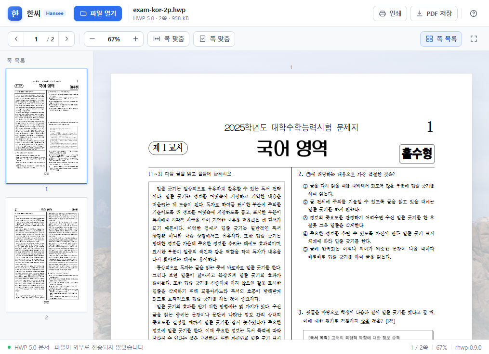

# 한씨 (Hansee) v1.0.2 · HWP / HWPX


한씨(Hansee)는 HWP 5.0(바이너리)과 HWPX(OWPML) 문서를 **원본 레이아웃 그대로** 열어 보는 로컬 뷰어입니다.
Rust + WebAssembly 엔진([rhwp](https://github.com/edwardkim/rhwp))으로 PC 안에서 직접 렌더링하며,
파일은 서버나 외부로 전송되지 않습니다.

<p align="center">
  <a href="https://github.com/narayo20/hansee/releases/latest">
    
  </a>
</p>

## 다운로드 (Windows)

| 버전 | 파일 | 크기 | 링크 |
| --- | --- | --- | --- |
| **v1.0.2** | `Hansee-1.0.2.exe` | 26 MB | **[다운로드](https://github.com/narayo20/hansee/releases/download/v1.0.2/Hansee-1.0.2.exe)** |

- 지원 환경: **Windows 10 / 11 (64-bit)**
- **Microsoft Edge WebView2 Runtime** 필요 — Windows 11에는 기본 포함되어 있고, Windows 10도 대부분 설치되어 있습니다.
  없다면 [Microsoft Edge WebView2 다운로드](https://developer.microsoft.com/microsoft-edge/webview2/)에서 설치하세요.
- 설치 없이 실행: 내려받은 `.exe` 파일을 더블클릭합니다.
- SmartScreen 경고가 표시되면 **추가 정보 → 실행**을 선택하세요. (서명되지 않은 오픈소스 실행 파일입니다.)
- 모든 버전과 변경 사항: [Releases](https://github.com/narayo20/hansee/releases)

> SHA-256 체크섬은 [릴리스 노트](https://github.com/narayo20/hansee/releases/tag/v1.0.2)에서 확인할 수 있습니다.

## 스크린샷

배경에는 대한민국의 명산인 **설악산** 사진을 사용했습니다. (사진 출처는 [이미지 및 오픈소스 출처](docs/CREDITS.md) 참고)

<p align="center">
  
  
</p>

## 주요 기능

- **HWP 5.0 · HWPX 지원** — 두 형식을 자동으로 구분해 엽니다.
- **원본 레이아웃 렌더링** — 문단, 표, 이미지, 머리말/꼬리말, 각주, 도형을 SVG로 표시합니다.
- **쪽 목록** — 왼쪽 미리보기에서 원하는 쪽으로 바로 이동합니다.
- **확대/축소** — 10%~400%, `폭 맞춤`, `쪽 맞춤`, `Ctrl + 휠`.
- **연속 스크롤** — 쪽 번호 입력, 이전/다음 쪽 이동.
- **인쇄** — 벡터(SVG) 상태로 인쇄해 글자가 선명합니다.
- **PDF 저장** — 현재 문서를 PDF 파일로 내려받습니다.
- **암호 문서** — 비밀번호가 걸린 문서는 입력 후 열 수 있습니다.
- **드래그 앤 드롭** — 파일을 창에 끌어다 놓으면 바로 열립니다.
- **100% 오프라인** — 인터넷 연결 없이 동작하며, 파일을 어디에도 업로드하지 않습니다.
- **데스크톱 앱** — WebView2 네이티브 창에서 실행되며, 인쇄는 Windows 인쇄 대화상자를 사용합니다.

## 실행 방법

### 1. Windows EXE (권장)

[다운로드](#다운로드-windows)에서 `Hansee-1.0.2.exe`를 받아 더블클릭합니다.

- 별도 설치 과정이 없습니다.
- 로컬 서버는 `127.0.0.1`의 임의 포트에서만 열리고, 창을 닫으면 함께 종료됩니다.
- 실행 로그: `%TEMP%\hansee.log`

### 2. 브라우저 모드

```bash
npm install
npm run build
python serve.py
```

`http://127.0.0.1:8765/` 가 자동으로 열립니다. 포트를 바꾸려면:

```bash
python serve.py --port 9000
```

브라우저를 자동으로 열지 않으려면 `--no-browser`를 붙입니다.

### 3. 개발 모드

```bash
npm install
npm run dev
```

`http://localhost:5173/` 에서 수정 사항이 즉시 반영됩니다.

## 사용법

1. **파일 열기** 버튼을 누르거나 `.hwp` / `.hwpx` 파일을 화면에 끌어다 놓습니다.
2. 왼쪽 쪽 목록 또는 상단의 쪽 번호로 이동합니다.
3. 툴바에서 배율을 조절하고, 필요하면 **인쇄** 또는 **PDF 저장**을 누릅니다.

### 단축키

| 동작 | 단축키 |
| --- | --- |
| 파일 열기 | `Ctrl + O` |
| 인쇄 | `Ctrl + P` |
| PDF 저장 | `Ctrl + S` |
| 확대 / 축소 | `Ctrl + +` / `Ctrl + -` |
| 폭 맞춤 | `Ctrl + 0` |
| 이전 / 다음 쪽 | `Alt + ←` / `Alt + →` |
| 전체 화면 | `F11` 또는 툴바 버튼 |

## 폴더 구조

```
hansee/
├─ index.html            # 화면 구조
├─ src/
│  ├─ main.js            # 뷰어 상태, 렌더링, 탐색, 단축키
│  ├─ export.js          # 인쇄 및 PDF 저장
│  └─ styles.css         # UI 스타일 (인쇄 스타일 포함)
├─ public/
│  ├─ favicon.svg
│  └─ mountains.jpg      # 배경 사진 (설악산)
├─ docs/
│  ├─ screenshot.png     # README 화면 예시
│  ├─ screenshot-empty.png
│  ├─ CREDITS.md
│  └─ release-notes-v1.0.2.md
├─ assets/
│  └─ icon.ico           # EXE/창 아이콘
├─ launcher.py           # 데스크톱 실행기 (로컬 서버 + WebView2 창)
├─ build_exe.bat         # Windows EXE 빌드 스크립트
├─ serve.py              # 브라우저 모드 정적 서버 (127.0.0.1 전용)
├─ run.bat               # 브라우저 모드 간편 실행
└─ package.json
```

## EXE 직접 빌드

필요 환경: **Python 3.10+**, **Node.js 20+**

```bat
python -m pip install pyinstaller pywebview
npm install
build_exe.bat
```

또는 직접 실행:

```bat
npm run build
python -m PyInstaller --noconfirm --clean --onefile --windowed ^
  --name "Hansee" --icon "assets\icon.ico" ^
  --add-data "dist;dist" --distpath "." --workpath "build\pyinstaller" ^
  --specpath "build" "launcher.py"
```

완료되면 프로젝트 폴더에 `한씨.exe`(또는 `Hansee.exe`)가 생성됩니다.
`dist` 폴더가 EXE 안에 함께 들어가므로 실행 파일 하나로 동작합니다.

## 동작 방식

- **파싱/렌더링**: `@rhwp/core` (Rust → WebAssembly). HWP/HWPX를 읽어 페이지별 SVG를 만듭니다.
- **화면 표시**: SVG를 페이지 컨테이너에 삽입하고, 화면에 가까운 쪽만 지연 렌더링합니다.
  페이지마다 겹치는 `clipPath` ID는 문서 내에서 고유하도록 다시 씁니다.
- **인쇄**: 브라우저 모드에서는 `window.print()`, 데스크톱 앱에서는
  `CoreWebView2.ShowPrintUI(System)`로 Windows 인쇄 대화상자를 엽니다.
- **PDF 저장**: 각 페이지를 192DPI 캔버스로 그린 뒤 `jsPDF`로 이미지 PDF를 만듭니다.
  (텍스트가 아닌 이미지 PDF이므로, 검색 가능한 PDF가 필요하면 인쇄 대화상자의
  "PDF로 저장"을 이용하세요.)
- **글꼴**: 문서에 지정된 글꼴이 PC에 없으면 SVG의 대체 글꼴 목록에 따라
  맑은 고딕, 바탕, Noto Sans KR 등 설치된 글꼴로 표시됩니다.

## 알려진 제한

- HWP 3.0 이하, HML 등 일부 오래된 형식은 지원 범위가 제한적입니다.
- 문서에 사용된 특수 글꼴이 PC에 없으면 글자 폭과 줄바꿈이 원본과 조금 달라질 수 있습니다.
- 암호 문서는 비밀번호를 3회까지 입력할 수 있습니다.
- 300MB를 넘는 파일은 열지 않습니다.
- PDF 저장은 페이지를 이미지로 변환하므로 파일 크기가 커질 수 있습니다.
- 이 앱은 파일을 읽기 전용으로 표시하며, 문서를 수정하거나 저장하지 않습니다.

## v1.0.2 변경 사항

- 프로그램 이름을 **한씨 (Hansee)** 로 변경
- 앱 아이콘·파비콘·상단 브랜드 표기를 새 이름에 맞게 갱신
- 실행 파일 이름 `한씨.exe` / 릴리스 자산 `Hansee-1.0.2.exe`
- 실행 로그 경로 `%TEMP%\hansee.log`
- 저장소 이름 `narayo20/hansee`로 변경

## v1.0.1 변경 사항

- 프로그램 배경을 대한민국의 명산(설악산) 사진으로 변경
- 문서 가독성을 위해 배경 위에 옅은 안개색 오버레이 적용
- 도움말에 버전 및 사진 출처 표기

## v1.0.0 변경 사항

- HWP 5.0 / HWPX 뷰어, 쪽 목록, 확대/축소, 쪽 이동
- 인쇄 및 PDF 저장
- 암호 문서 열기
- Windows 단일 실행 파일 및 WebView2 데스크톱 창
- 데스크톱 앱 네이티브 인쇄 대화상자 지원

## 개인정보

- 모든 처리는 사용자의 PC(로컬 WASM)에서 이루어집니다.
- 로컬 서버는 `127.0.0.1`에만 바인딩되며, 외부에서 접근할 수 없습니다.
- 열어본 문서, 파일 이름, 내용을 어디에도 저장하거나 전송하지 않습니다.

## 라이선스 및 상표

- 이 프로젝트의 뷰어 UI 코드: [MIT](LICENSE)
- 배경 사진: 설악산 · Olga Lipunova · [CC BY-SA 3.0](https://creativecommons.org/licenses/by-sa/3.0/) — [출처](docs/CREDITS.md)
- [`@rhwp/core`](https://github.com/edwardkim/rhwp): MIT
- [`jsPDF`](https://github.com/parallax/jsPDF): MIT
- [`Vite`](https://vite.dev/): MIT

"한글", "한컴", "HWP", "HWPX"는 주식회사 한글과컴퓨터의 등록 상표입니다.
이 프로그램은 한글과컴퓨터와 제휴·후원·보증 관계가 없는 독립 오픈소스 프로젝트입니다.
