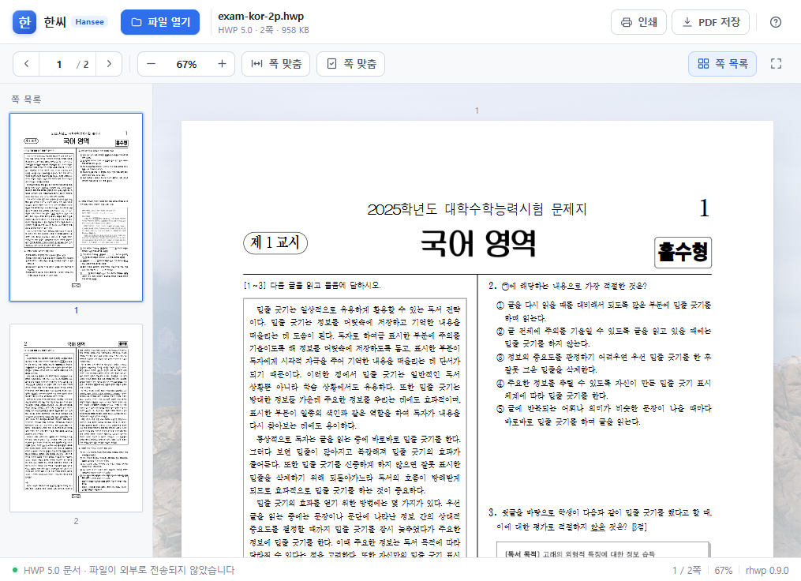

# 한씨 (Hansee) v1.0.2

HWP 5.0과 HWPX 문서를 원본 레이아웃 그대로 열어 보는 Windows용 로컬 뷰어입니다.
모든 렌더링은 PC 안에서 이루어지며, 문서는 외부로 전송되지 않습니다.



## 다운로드

| 파일 | 크기 | 설명 |
| --- | --- | --- |
| **Hansee-1.0.2.exe** | 26 MB | 설치 없이 실행하는 Windows 단일 실행 파일 (앱 이름: 한씨) |

- **지원 환경**: Windows 10 / 11 (64-bit)
- **필수 런타임**: Microsoft Edge WebView2 Runtime
  (Windows 11 기본 포함, Windows 10은 대부분 설치됨)
  - 없다면 [WebView2 다운로드](https://developer.microsoft.com/microsoft-edge/webview2/)에서 설치하세요.
- 실행: 내려받은 `.exe`를 더블클릭합니다.
- SmartScreen 경고가 나오면 **추가 정보 → 실행**을 선택하세요.
  (서명되지 않은 오픈소스 실행 파일입니다.)

### 체크섬

```text
SHA-256  86ED95E901065ECB2989A60FFF87EA11D99F6245394A149243F07EAB59187E92
```

## v1.0.2 변경 사항

- 프로그램 이름을 **한씨 (Hansee)** 로 변경
- 앱 아이콘·파비콘·상단 브랜드 표기를 새 이름에 맞게 갱신
- 실행 파일 이름 `한씨.exe` / 릴리스 자산 `Hansee-1.0.2.exe`
- 실행 로그 경로 `%TEMP%\hansee.log`
- 저장소 이름 `narayo20/hansee`로 변경

이전 버전(v1.0.1)의 설악산 배경과 모든 기능은 그대로 유지됩니다.

## 주요 기능

- HWP 5.0(바이너리) · HWPX(OWPML) 자동 인식
- 문단, 표, 이미지, 머리말/꼬리말, 각주, 도형을 SVG로 렌더링
- 쪽 목록 미리보기 및 쪽 번호 이동
- 10%~400% 확대/축소, 폭 맞춤, 쪽 맞춤
- 벡터 기반 인쇄 및 PDF 저장
- 암호 문서 열기
- 드래그 앤 드롭으로 파일 열기
- 완전 오프라인 동작 (파일 업로드 없음)
- 설악산 배경 이미지

## 사용법

1. **파일 열기** 버튼을 누르거나 `.hwp` / `.hwpx` 파일을 창에 끌어다 놓습니다.
2. 왼쪽 쪽 목록이나 상단의 쪽 번호로 이동합니다.
3. 툴바에서 배율을 조절하고 **인쇄** 또는 **PDF 저장**을 누릅니다.

### 단축키

| 동작 | 단축키 |
| --- | --- |
| 파일 열기 | `Ctrl + O` |
| 인쇄 | `Ctrl + P` |
| PDF 저장 | `Ctrl + S` |
| 확대 / 축소 | `Ctrl + +` / `Ctrl + -` |
| 폭 맞춤 | `Ctrl + 0` |
| 이전 / 다음 쪽 | `Alt + ←` / `Alt + →` |
| 전체 화면 | `F11` |

## 알려진 제한

- HWP 3.0 이하, HML 등 일부 오래된 형식은 지원 범위가 제한적입니다.
- 문서에 사용된 특수 글꼴이 PC에 없으면 글자 폭과 줄바꿈이 원본과 조금 달라질 수 있습니다.
- 암호 문서는 비밀번호를 3회까지 입력할 수 있습니다.
- 300MB를 넘는 파일은 열지 않습니다.
- PDF 저장은 페이지를 이미지로 변환하므로 파일 크기가 커질 수 있습니다.
- 문서를 수정하거나 저장하지 않는 읽기 전용 뷰어입니다.

## 이미지 출처

배경 사진: **설악산 국립공원** · Olga Lipunova · [CC BY-SA 3.0](https://creativecommons.org/licenses/by-sa/3.0/)
· [Wikimedia Commons](https://commons.wikimedia.org/wiki/File:Seoraksan_National_Park,_landscape.jpg)

## 라이선스

- 뷰어 UI 코드: MIT
- [@rhwp/core](https://github.com/edwardkim/rhwp): MIT
- [jsPDF](https://github.com/parallax/jsPDF): MIT
- [Vite](https://vite.dev/): MIT

"한글", "한컴", "HWP", "HWPX"는 주식회사 한글과컴퓨터의 등록 상표입니다.
이 프로그램은 한글과컴퓨터와 제휴·후원·보증 관계가 없는 독립 오픈소스 프로젝트입니다.
